# .github <div align="center">



<br/>

[](https://github.com/Lynxifyy)

<a href="#-whois-lynx"></a>
<a href="#-quest-log"></a>
<a href="#-inventory"></a>
<a href="#-stats"></a>
<a href="#-contact"></a>

<br/><br/>


</div>

---

## 📜 `/whois lynx`

<table>
<tr>
<td width="140" align="center" valign="top">


**lynx**<br/>
<sub>aka `echofrostt`</sub>

</td>
<td valign="top">

```yaml
player:        lynx
class:         Script API Smith
armor:         Full diamond (Protection IV, Mending)
main_hand:     Diamond axe (Sharpness V)
spawn_point:   The Terminal
home_biome:    Open Source
current_quest: BerryAPI
rival:         haters (win rate against them: 100%)
weakness:      Creepers, a.k.a. production bugs at 5pm on Friday
```

</td>
</tr>
</table>

- 🔭 **Currently working on:** [BerryAPI](https://github.com/Lynxifyy/BerryAPI)
- 🌱 **Currently learning:** Python
- 🤝 **Looking to collaborate with:** Blueberry client devs
- 💬 **Ask me about:** coding
- ⚡ **Fun fact:** I never knew I was this good at making script APIs

---

## 🗺️ Quest Log

<div align="center">

<table>
<tr>
<td align="center" width="33%" valign="top">
<a href="https://github.com/Lynxifyy/BerryAPI"></a>
<h3><a href="https://github.com/Lynxifyy/BerryAPI">BerryAPI</a></h3>
<b>Creator</b><br/>
<sub>A native injected C++ shared library for Minecraft Bedrock modding and performance debugging, with a capability-gated script host and one IDL that generates the bindings.</sub><br/><br/>


</td>
<td align="center" width="33%" valign="top">
<a href="https://github.com/ChimeraAnt-DEV/GlowberryClient"></a>
<h3><a href="https://github.com/ChimeraAnt-DEV/GlowberryClient">GlowberryClient</a></h3>
<b>One of the lead developers</b><br/>
<sub>An advanced Android launcher for Minecraft: Bedrock Edition with native mod loading, its own <code>.AntEgg</code> mod packs, a mod menu, voice chat and more.</sub><br/><br/>


</td>
<td align="center" width="33%" valign="top">
<a href="https://github.com/ChimeraAnt-DEV/BerryForge"></a>
<h3><a href="https://github.com/ChimeraAnt-DEV/BerryForge">BerryForge</a></h3>
<b>Official creator</b><br/>
<sub>An Android IDE made for GitHub users. It builds, reviews and ships, right on the device, with an embedded MCP server and an AI code review flow.</sub><br/><br/>


</td>
</tr>
</table>

<a href="https://github.com/Lynxifyy/BerryAPI"></a>
<a href="https://github.com/ChimeraAnt-DEV/GlowberryClient"></a>
<a href="https://github.com/ChimeraAnt-DEV/BerryForge"></a>

</div>

---

## 🎒 Inventory

> Hotbar: the tools behind the projects above.

<div align="center">


<br/>


</div>

<details>
<summary><b>🔍 Open the enchantment table</b></summary>
<br/>

| Slot | Item | Used for | Enchantment |
|:----:|:-----|:---------|:------------|
| ⚔️ | C++ | BerryAPI, the native injected library | Sharpness |
| ⛏️ | Kotlin / Java | GlowberryClient and BerryForge | Efficiency |
| 🧪 | Lua | `.AntEgg` script mods | Fire Aspect |
| 📜 | Script APIs | Capability-gated script hosts | Mending |
| 🐍 | Python | Currently learning | Unbreaking (in progress) |

</details>

---

## 📊 Stats

<div align="center">


</div>

### 🐍 Contribution snake

<div align="center">

<picture>
  <source media="(prefers-color-scheme: dark)" srcset="https://raw.githubusercontent.com/Lynxifyy/Lynxifyy/output/github-snake-dark.svg"/>
  
</picture>

</div>

> The snake needs the included workflow (`.github/workflows/snake.yml`). Run it once from the **Actions** tab and it will keep itself updated daily.

---

## 🍖 Player Status

```
 Health   ♥ ♥ ♥ ♥ ♥ ♥ ♥ ♥ ♥ ♥     (all hearts, haters never land a hit)
 Hunger   🍗🍗🍗🍗🍗🍗🍗🍗🍗🍗     (fueled by coffee)
 Armor    🛡🛡🛡🛡🛡🛡🛡🛡🛡🛡     (full diamond)
 XP       ▓▓▓▓▓▓▓▓▓▓▓▓▓▓▓▓░░░░  Level 64 and climbing
```

---

## ☠️ Death Messages

- `haters was slain by lynx`
- `lynx was blown up by a null pointer`
- `lynx fell from a high place (merged straight to main)`
- `haters swung and missed (again)`

---

## 📡 Contact

<div align="center">

Discord is the best way to reach me. Come talk code, scripting APIs, or Blueberry client collabs.

<a href="https://discord.com/users/1002131928775925840"></a>

<br/>

```
> /say Thanks for stopping by!
<lynx> Build something awesome. See you in the next chunk.
```


<sub>⛏️ Built with diamonds, caffeine, and zero tolerance for haters ⚔️</sub>

</div>
